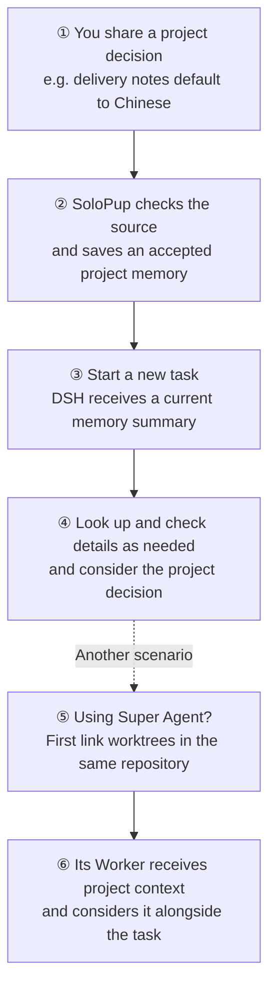

# SoloPup Memory

**Start here:** [Quick start](docs/guides/quickstart.md) · [Synthetic trials](docs/README.md) · [FAQ](docs/faq.md) · [Feedback](docs/feedback.md)

**Remember what matters. Keep up when you change your mind.** · [中文](README.md)

Source-linked, layered **text memory** for DeepSeek Harness. **Public beta, not a stable release.** See the npm beta tag and GitHub releases for the currently published version. See [RELEASE.md](RELEASE.md) for tested scope and known gaps.

## How memory helps later



This is a simplified flow: a memory may not be saved or recalled, and a model can misinterpret it. Super Agent Workers do not necessarily have memory search or write tools by default. [See setup and test limitations](docs/runs/2026-11-12-superagent-examples.md).

## Explain it once, use it later

This dialogue is a readable summary of an isolated test with a fictional project and real model sessions:

> **You:** “Remember: this project's delivery notes should default to Chinese.”<br>
> **SoloPup:** Saves it as a project decision.
>
> **Later, in another worktree:** “An old task used English. What is the default now?”<br>
> **DSH:** “Chinese. The current project memory says Chinese; the old task record needs its timing and scope checked.”

**Why it helps:** You do not need to explain the project decision from scratch in every worktree. The test required an explicit link between two worktrees in the same repository. One observation does not guarantee every model decision.

### Project context for Super Agent

Super Agent is a DSH prototype that can organize AI work. In another isolated test, a Worker received the same project memory and an old English-language task record. A real model chose Chinese and stated that it had only seen the memory summary.

The test used prototype components and a real model, but some orchestration and events were test doubles and model context was adapted; **it was not full production acceptance**. After a prepare failure, the prototype can retry without project memory: inspect the leftover workspace and ensure preparation reruns before retrying. Withdrawing a memory does not automatically erase old session copies. [Read the test details and limitations](docs/runs/2026-11-12-superagent-examples.md).

## Quick install

Requires an installed DeepSeek Harness and Node >=24.9. For the desktop profile:

```sh
dsh plugin --profile desktop add solopup-memory@beta --ignore-scripts
```

Restart that profile's host, then use `memory_status` to check the loaded version and status. If upgrading from `dsh-memory`, back up and remove the old plugin first; do not enable both. See [installation details](#install-in-dsh) for exact versions, legacy-store review and removal.

## What does a source-linked result look like?

These are **actual offline script results from Linux x64 / Node v24.22.1 on 2026-11-07**. They use a fictional message and production tool handlers in a scripted host, with a stubbed approval response. Write, same-project recall and other-project recall run in three separate Node processes; neither reader inherits old messages. **This is not a real DSH conversation or a real-model semantic evaluation.**

```text
synthetic user: 记住：本项目的交付说明统一用中文。
memory_write: recorded (scope=project, meaning=decision)
fresh process / memory_search("交付说明"): 1 hit (scope=project)
current text: - [project] 本项目的交付说明统一用中文 — 索引摘要
history source: synthetic-demo-write:1; quote: 记住：本项目的交付说明统一用中文。
other project / current + history: 0 + 0 hits
```

The Chinese message asks to keep this project's delivery notes in Chinese. Current search returns its effective summary. A separate `memory_search({query: "交付说明", mode: "exact", view: "history"})` returns the original quote and message identity; historical content is not a current instruction. The six lines summarize tool results. See the [full receipt and limitations](docs/runs/2026-11-07-source-recall.md), or run `node scripts/demo-source-recall.mjs` from the checkout. [Natural fresh-chat acceptance](docs/guides/fresh-chat.md) still needs a separate DSH run.

## What it keeps

- Separate global preferences from project decisions.
- Keep original owner-message citations, conditions, exceptions and optional expiry.
- Review native writes and automatic capture before making new records effective.
- Keep corrections and historical values separate from current rules.
- Represent preferences, decisions, claims, beliefs, values, references and episodes without treating memory as proof or permission to act.
- Coordinate source withdrawal across managed stores and preserve withdrawal barriers during a reviewed restore.

## Install in DSH

Use the official plugin-manager command in [Quick install](#quick-install).

The beta tag follows verified public beta releases. For an exact version, choose a published version from the release page, for example `solopup-memory@0.22.0-beta.3`. Git installation remains available with `github:OakcoderX/solopup-memory#v0.22.0-beta.3`; the release page supplies a full commit SHA for an immutable Git pin. This package ships executable ESM and has no dependency installation or build scripts. Alternatively download its release tarball and install the local file with `dsh plugin --profile desktop add /absolute/path/to/solopup-memory-0.22.0-beta.3.tgz --offline --ignore-scripts`.

Restart the profile and use `memory_status`. Existing legacy stores may require explicit local review. Do not delete control files to bypass that review. If upgrading from `dsh-memory`, create a full private backup, stop the hosts using that data, remove the old package, then install SoloPup Memory. Do not run both packages together. The data location and legacy format identifiers are intentionally retained.

Uninstalling preserves data:

```sh
dsh plugin --profile desktop remove solopup-memory
```

For DSH's experimental **Custom plugin markets**, add this source in Discover:

```text
https://raw.githubusercontent.com/OakcoderX/solopup-memory/main/market/index.json
```

This is a self-hosted index using the official format, not an official endorsement or a default built-in listing.

## Storage and limitations

Markdown stores indexes and topic text. Local ledgers store sources, candidates, revisions and invocation history. A separate SQLite coordinator stores managed identity and source-withdrawal state. A Markdown-only copy is not a complete backup. Use `scripts/backup.mjs`; [Chinese backup instructions](README.md) describe reviewed restore and retained withdrawal controls.

Automatic capture normally attempts every four turns. Native `memory_write` also requires source review. Pending, rejected and unapplied proposals are not effective memories. Model review may miss information or misinterpret it. Check the original sources for important decisions.

Retrieval uses lexical matching, not embeddings; cross-language and synonym recall are limited. A user message must fit the current 2,000-character complete-source window. Long sources are refused rather than silently shortened into memory. Withdrawal covers tracked managed projections, not original chats, remote services, external backups or unknown copies. Memory does not authorize sending messages, buying, deleting or publishing. This is not a full probabilistic POMDP solver.

Verified locally on macOS with DSH Node 24. Other runtime/platform results must be read from actual CI and release receipts; registration or unit tests alone do not establish semantic quality or sustained-use acceptance.

## Project memory across worktrees (0.23 beta)

This feature starts in 0.23.0-beta.1 and is not part of 0.22.0-beta.3. Project stores remain separate by default. To explicitly link a worker worktree to an existing project store in the same local Git repository, run from the source or installed package directory:

```sh
node scripts/projects.mjs link --cwd /path/to/worker-worktree --owner /path/to/project-worktree
# Inspect the preview and use its reviewed value:
node scripts/projects.mjs link --cwd /path/to/worker-worktree --owner /path/to/project-worktree --apply --reviewed-link <reviewed>
```

The owner must already have a project store. Linking refuses an existing separate worker store; it does not merge or overwrite it. Clones are not linked automatically, and moving or restoring a repository can require registration again. Unlink using the same preview-then-apply process; it does not delete memory:

```sh
node scripts/projects.mjs unlink --cwd /path/to/worker-worktree
node scripts/projects.mjs unlink --cwd /path/to/worker-worktree --apply --reviewed-link <reviewed>
```

Unlinking changes subsequent directory resolution; it is not immediate revocation for running work. Previously resolved store paths, in-flight capture jobs, and content already in sessions are not automatically invalidated or deleted. Stop the affected Workers and memory capture before unlinking, and review existing copies separately.

To opt in from a Super Agent prepare command, append the following **after** the worktree creation command, replacing paths with local absolute paths. The plugin does not alter the Super Agent configuration. If creating or linking fails, this launch stops. The Super Agent prototype can skip preparation on retry when the directory remains; do not retry until the leftover directory is inspected and preparation is certain to run again.

```sh
node /absolute/path/to/solopup-memory/scripts/superagent-worktree.mjs --owner /absolute/path/to/project-worktree --apply
```

The helper reads `DSH_SUPERAGENT_DIR` supplied by the Super Agent and retains same-repository and existing-store checks. `--apply` records the user’s opt-in through the trusted prepare configuration.

In the tested Super Agent prototype, default Worker tool restrictions do not expose `memory_search` or `memory_write`. A linked project can supply memory context to the Worker, but this does not enable direct use of those tools or establish Worker-initiated memory writes.

Linking does not remove copies already sent to a model or stored in ordinary session history. Real-model semantic quality and all platforms have not been validated.

## Development

Requires Node >=24.9. No npm dependencies are needed for the test suite. Tests live in `test/`; runtime modules retain their existing paths. The full explicit test set is preserved in both `npm test` and the package archive.

```sh
npm test
node scripts/verify.mjs --no-accept
node accept.mjs --profile desktop
```

`verify` additionally requires a locally installed DSH and runs isolated load and mechanical gates. `accept` reads the selected profile and the live version marker; it does not certify natural-dialogue quality. See [SECURITY.md](SECURITY.md), [COMPATIBILITY.md](COMPATIBILITY.md) and [CHANGELOG.md](CHANGELOG.md).

MIT License. Copyright © 2026 oakfilm.

Explicit requests to remember durable information are directed to the native `memory_write` tool in the same turn. A separate protocol context is available even when the memory store is empty. Personal self-reports remain claims; assistant guesses are not confirmed facts. Automatic capture uses short, code-bound source labels before the original identity and quote checks. This remains a public beta, and instructions do not guarantee model compliance.

Recognized private content is excluded from automatic memory projection and unrelated saved-memory context in capture/admission review. Current and historical search hide it by default; includePrivate=true enables explicit on-demand retrieval. These are conservative content rules, not exhaustive classification or a filesystem security boundary. Raw Markdown and provenance remain local plaintext. Explicit retrieval still enters session history and model requests. Existing session archives, exports, backups and already-sent data are not erased.
