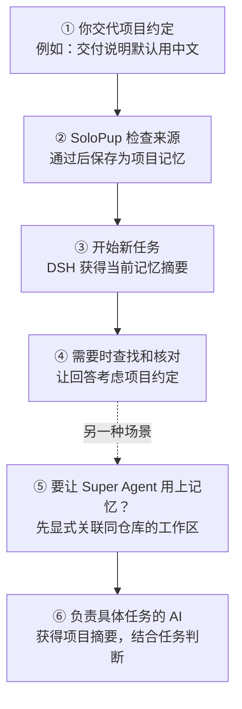

# SoloPup Memory

**新用户入口：** [快速上手](docs/guides/quickstart.md) · [六个虚构试用案例](docs/README.md) · [常见问题](docs/faq.md) · [反馈](docs/feedback.md)

**记住重要的事，跟上你的改变。** · [English](README.en.md)

这是文字记忆公开测试版，尚未通过稳定版验收。当前发行版本以 [npm beta 标签](https://www.npmjs.com/package/solopup-memory) 与 [GitHub 发行页](https://github.com/OakcoderX/solopup-memory/releases) 为准。已验证范围和已知问题见 [RELEASE.md](RELEASE.md)。

SoloPup 是 DSH 的文字记忆插件：把你说过的重要偏好和项目决定保存下来，让后续任务有机会用上它们。

## 记忆怎样帮到后续任务？



图中是简化的使用流程：记忆可能未被保存、未被召回或被模型误判；Super Agent 默认不一定提供记忆检索和写入工具。[查看接入条件和测试限制](docs/runs/2026-11-12-superagent-examples.md)

## 一次说明，以后接着用

下面把一次使用虚构项目、真实模型的隔离测试整理成对话，方便阅读：

> **你先交代：**“记住，这个项目的交付说明默认用中文。”<br>
> **SoloPup：** 保存为这个项目的决定。
>
> **后来，在另一个工作区：**“旧任务记录说用英文，这次默认用什么？”<br>
> **DSH：**“默认用中文。当前项目记忆是中文；英文是旧任务记录，还需要核对它的时间和适用范围。”

**你得到的好处：** 换了工作区后，不必每次从头交代项目约定。测试中需要先把同一仓库的两个工作区显式关联；结果是一次观察，不保证模型每次都判断正确。

### Super Agent 也能用上项目背景

Super Agent 是 DSH 中可以安排多个 AI 工作任务的原型。另一项隔离测试中，Worker（负责具体任务的 AI）收到了同样的“默认中文”项目记忆和“旧任务用英文”的任务信息，真实模型选择中文，并说明它只看到了记忆摘要。

这次使用了原型组件和真实模型，但部分调度与事件由测试替身提供，模型接收的上下文也经过适配，**还不是完整生产流程验收**。原型准备失败后直接重试，Worker 可能缺少项目记忆；请先检查残留工作区并确保准备重新执行。记忆撤回也不会自动清除旧会话副本。[查看测试过程与限制](docs/runs/2026-11-12-superagent-examples.md)

## 先试起来

需要已安装 DeepSeek Harness，Node >=24.9。以下以 desktop profile 为例：

```sh
dsh plugin --profile desktop add solopup-memory@beta --ignore-scripts
```

重启该 profile 的宿主后，用 `memory_status` 确认插件版本与状态。升级旧名 `dsh-memory` 前先完整备份并移除旧插件，不能同时启用两个插件；固定版本、旧库检查和卸载见[安装与卸载](#安装与卸载)。

## 原话来源会怎样返回？

下面是 **2026-11-07 在 Linux x64 / Node v24.22.1 实际执行的离线示例输出**，使用虚构消息、生产工具处理函数和脚本化宿主；审查回复由测试桩固定通过。写入、同项目检索、另一项目检索分别在三个新 Node 进程中运行，后两者不继承旧消息。**这不是实际 DSH 聊天或真实模型的语义验收。**

```text
synthetic user: 记住：本项目的交付说明统一用中文。
memory_write: recorded (scope=project, meaning=decision)
fresh process / memory_search("交付说明"): 1 hit (scope=project)
current text: - [project] 本项目的交付说明统一用中文 — 索引摘要
history source: synthetic-demo-write:1; quote: 记住：本项目的交付说明统一用中文。
other project / current + history: 0 + 0 hits
```

当前查询返回有效摘要；另一次 `memory_search({query: "交付说明", mode: "exact", view: "history"})` 返回原话及消息来源，历史内容不能当作当前指令。以上六行是工具结果摘要，完整返回值和局限见[运行记录](docs/runs/2026-11-07-source-recall.md)。在源码目录运行 `node scripts/demo-source-recall.mjs` 可复现；真正的[换聊天验收](docs/guides/fresh-chat.md)仍需在 DSH 中另做。

## 个人资料与按需读取

已识别的生日、性别、健康、亲密关系和私人联系方式默认不进入自动索引投影，也不作为无关后台整理或写入审查的旧记忆发送。普通 `memory_search` 默认隐藏这些内容；用户询问相关资料时，才明确使用 `includePrivate: true`。主题文件含有未分段的敏感内容时，普通搜索会保守跳过整个主题文件，安全的索引摘要仍可检索。

这是内容规则提供的降载保护，不是完整的隐私分类器。未识别的改写仍可能漏过；文件工具仍能读原始文件，按需读取结果也会进入当前会话日志和模型请求。此版本没有把原始 `MEMORY.md` 改成无明文的指针库，没有擦除既有日志、缓存、备份或已发送数据。`memory_forget` 表示停止使用索引条目，不表示彻底删除个人信息。

## 工作过程

1. 从本会话已接收的用户消息提出候选，并绑定原话引用。
2. 独立检查持久价值、归属、措辞、认识类型、适用条件、信念归属和修订关系。审查不能改写候选。
3. 通过检查后才发布到有效记忆。明确拒绝的不写入；无法判断的新候选可以留在不自动注入的待审区。未通过的替换请求不降格成普通追加。
4. 后续对话自动得到受预算限制的索引；检索同时查当前项目与全局库，结果标明归属。其他项目不会因此自动变成当前项目的记忆。

用户明确要求记住持久信息时，插件指令要求本轮使用正式 `memory_write`，等待实际结果再确认；不等待后台整理。本人陈述的个人资料按未独立核实的 `claim` 保存，助手猜测不能冒充本人确认。模型仍可能不遵循指令，因此需要实际调用与新会话验收。

默认每四轮尝试一次后台整理。主动 `memory_write` 也经过来源审查。`pending-review`、`rejected`、`not-applied` 都不表示已经记住。

## 记忆的层次

| 层次 | 内容与用途 |
|---|---|
| 来源 | 用户原话与消息身份；工具观察另带当时输出的核对证书 |
| 候选 | 尚待判断的解释；待审内容不进入常规有效记忆 |
| 有效记忆 | 全局个人约定或当前项目内容，带条件、例外及可选期限 |
| 修订历史 | 解释旧值与新值的关系；旧值不能继续冒充当前默认值 |
| 认识状态 | 偏好、决定、未核实主张、暂定信念、价值取向、查证入口和经历分别表示 |

“我负责剪辑”可以保存为本人报告的分工，但不等于外部事实已被独立证实。信念可以保留竞争解释和反证条件；这不是完整的 POMDP 概率求解器。记忆也不构成发邮件、购买、删除或发布的操作授权。

## 存储与修改

Markdown 索引和主题正文便于阅读；来源、候选、历史与调用记录使用有格式校验的本地账本；独立 SQLite 控制库维护受管身份、撤回和协调状态。不要只备份 Markdown 就认为已完整备份系统。

改同一条约定的值时，`supersedes` 指向唯一现行旧行，默认保留原来的归属、认识类型、条件、例外和期限及其来源。改变这些边界时使用完整重述路径 `revisionMode=replace`，由本轮用户来源支持全部新内容。仅确认“其他项目也一样”不应再建副本。兼容补充不自动变成一般规则的例外。

条件全部成立才满足 `conditions`；任何一个例外成立就命中 `except`。同一条件不能既必须成立又必须排除。来源上限超出时明确拒绝，不截掉必要来源来凑数。

## 跨 worktree 项目记忆（0.23 测试版）

以下功能从 0.23.0-beta.1 开始提供，不属于 0.22.0-beta.3。默认各工作目录仍使用各自的项目库。若主 Agent 与 Worker 使用同一 Git 仓库的不同 worktree，可在源码或安装包目录中通过本地命令显式关联：

```sh
node scripts/projects.mjs link --cwd /path/to/worker-worktree --owner /path/to/project-worktree
# 核对预览后，将返回的 reviewed 填入：
node scripts/projects.mjs link --cwd /path/to/worker-worktree --owner /path/to/project-worktree --apply --reviewed-link <reviewed>
```

来源目录须已有项目库；Worker 若已有独立项目库，命令会拒绝，不会合并或覆盖。关联会检查本地仓库身份，不自动关联克隆；仓库或文件系统迁移后可能需要重新登记。取消关联同样先预览、再使用 `reviewed` 执行，且不删除记忆：

```sh
node scripts/projects.mjs unlink --cwd /path/to/worker-worktree
node scripts/projects.mjs unlink --cwd /path/to/worker-worktree --apply --reviewed-link <reviewed>
```

取消关联只改变之后的目录解析，不是运行中任务的即时撤权：已解析出的项目库路径、正在处理的捕获任务及已进入会话的内容不会因此自动失效或删除。需要停止使用该共享关系时，先停止相关 Worker 和记忆捕获，再取消关联；历史副本须另行检查。

超级 Agent 的准备命令可以在创建 worktree **之后**，显式追加以下命令，自动登记该次 Worker 目录。请将路径替换为本机的绝对路径；这是一项用户主动配置，不会自动改写超级 Agent 设置。若创建或登记失败，本次启动会停止；超级 Agent 原型重试时可能因目录已存在而跳过准备命令，不能直接重试，须先检查残留目录并确保准备步骤会重新执行。

```sh
node /absolute/path/to/solopup-memory/scripts/superagent-worktree.mjs --owner /absolute/path/to/project-worktree --apply
```

该命令读取超级 Agent 提供的 `DSH_SUPERAGENT_DIR`，仍执行同仓库和已有独立库检查；`--apply` 表示用户在准备配置中授权执行关联。

在测试的超级 Agent 原型中，Worker 的默认工具限制不开放 `memory_search` 或 `memory_write`。关联可以让已登记的项目记忆进入 Worker 上下文，但不表示 Worker 可直接调用这些记忆工具；不要将其视为 Worker 主动写入记忆的支持。

关联不会清除已发送给模型或保存在普通会话中的副本。真实模型语义质量和全部跨平台环境尚未验收。

从 0.23.0-beta.2 起，记忆协议提示模型在任务历史与长期记忆不一致时核对来源、范围和时间；用户明确更正后按新要求工作，无法判断时向用户澄清。提示不能保证模型一定判断正确，也不会自动更改历史任务、清除会话副本或代替现有记忆写入审核。Worker 未配置记忆工具时，不能声称已经写入记忆。

## 安装与卸载

使用上方[先试起来](#先试起来)的 DeepSeek Harness 官方插件管理器命令安装。代码为可直接执行的 ESM，无安装时构建脚本，也不需要 npm 账户。

`beta` 标签跟随已公开并完成下载核验的测试版。需要固定版本时，从发行页选择准确版本号，例如 `solopup-memory@0.22.0-beta.3`；Git 安装也可用 `dsh plugin --profile desktop add github:OakcoderX/solopup-memory#v0.22.0-beta.3 --ignore-scripts`，需要不可变 Git 来源时，用发行页的完整提交 SHA 替换标签。也可下载发行页的 `.tgz`，使用 `dsh plugin --profile desktop add /absolute/path/to/solopup-memory-0.22.0-beta.3.tgz --offline --ignore-scripts`。

已安装旧名 `dsh-memory` 时，先完成完整备份、关闭使用该库的宿主，用官方管理器移除旧包，再安装新包；不要同时启用两个记忆插件。新名字继续使用原记忆库和控制格式。

重启该 profile 的宿主后，用 `memory_status` 核查插件版本、全局/项目状态及捕获诊断。已有旧库可能进入需要核对归属或旧撤回策略的状态；按本地预览结果处理，不删除控制文件绕过检查。

```sh
dsh plugin --profile desktop remove solopup-memory
```

可在插件页的实验插件中启用 **Custom plugin markets**，进入 Discover → Add index source，导入：

```text
https://raw.githubusercontent.com/OakcoderX/solopup-memory/main/market/index.json
```

这是自托管插件源，按官方格式提供；DSH 不默认内置任何市场源，不表示官方审核或推荐。

卸载保留记忆数据。重新安装同一位置的数据仍需通过身份与格式检查。

## 备份与恢复

先关闭使用这套记忆库的全部宿主与写入器。使用安装目录中的脚本，备份目标必须是不存在的新目录。

```sh
node /absolute/plugin/scripts/backup.mjs create --root /absolute/memory --to /absolute/new-backup
node /absolute/plugin/scripts/backup.mjs verify --snapshot /absolute/new-backup
node /absolute/plugin/scripts/backup.mjs restore --root /absolute/memory --snapshot /absolute/new-backup
```

恢复默认只预览。核对返回的目标、格式能力及 `review` 后，以相同参数加 `--apply --reviewed HASH` 执行。恢复保留当前撤回控制，不能靠旧快照重新启用已撤回来源；恢复数据也不会自动安装旧代码。

备份包含可能敏感的记忆正文，应保留在私有位置；不包含独立凭据、profile 或原始会话。中断恢复使用 `backup.mjs resume` 核查，不能通过删日志或控制库跳过屏障。

## 使用边界

- 模型可能漏记、误判或错误概括。重要决定应查原话与来源；程序格式检查不等于语义正确。
- 当前检索使用中英文词元及精确匹配，没有向量检索，不保证跨语言或同义表达的召回。
- 撤回覆盖受管库内已追踪的来源及相关投影；不承诺清除原始对话、远端服务、外部备份和未知副本。
- 未决的远端请求不会自动重发。调用次数、执行完成和真实计费分别记录。
- 当前验证环境为 macOS、DSH 宿主 Node 24；其他平台的验证状态以发行验收清单为准。

MIT License，Copyright © 2026 oakfilm。产品品牌：SoloPup Memory。

## 开发验证

测试集中在 `test/`，运行时模块保持原路径。`npm test` 和安装包都保留完整的显式测试集合。

```sh
npm test
node scripts/detect.mjs --check   # L0 不变量检测（只读）；有 error 退出码 1
node eval/semantic-suite.mjs     # L2 管道保真层（10 条冻结用例）
node eval/bench-detect.mjs       # 对比实验：检测器召回与耗时
node scripts/dream.mjs           # 做梦 P0 影子计划（只读）
node scripts/security-check.mjs  # 发版前机械安全自查
node scripts/soak.mjs            # 可靠性测试：官方安装 + 真实宿主多轮 + 崩溃恢复
node scripts/verify.mjs --no-accept
node accept.mjs --profile desktop
```

`verify --no-accept` 运行源码测试、隔离加载、原有机械评测及可用性检查；需要本地可用的 DSH。`accept` 只读核对实际 profile 安装与运行状态。实际归档和官方宿主另行验证；真实模型、冷启动召回、逐条语义复核及持续使用不能由这个命令替代。

详细安全边界见 [SECURITY.md](SECURITY.md)，宿主兼容范围见 [COMPATIBILITY.md](COMPATIBILITY.md)。

用户单条消息的完整来源窗口目前上限为 2000 字符。超长消息不从前半段建立记忆；自动整理显示来源不完整并暂不执行，主动写入也拒绝使用仍在当前核对窗口内的截断来源。可在新的短消息会话中完整重述需长期保留的约定。这个修复不会自动纠正旧版已经保存的解释。

市场源请求失败时，按 [DSH 官方代理手册](https://deepseek-harness.github.io/deepseek-harness/guide/network-proxy) 配置 DSH 自身的代理环境；DSH 不自动读取 macOS 系统代理。
