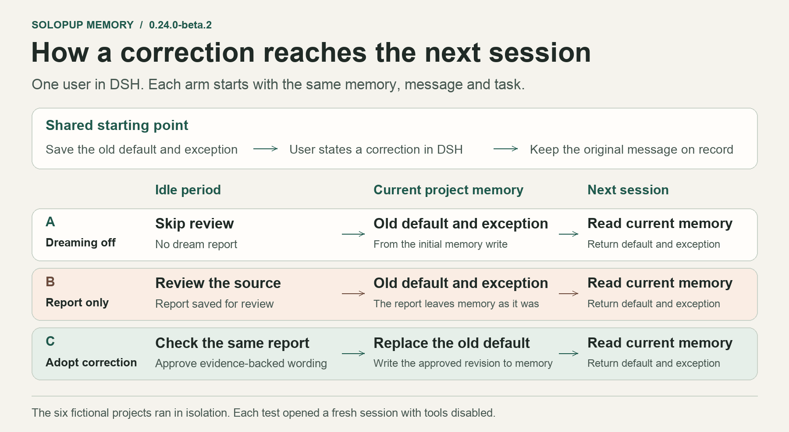
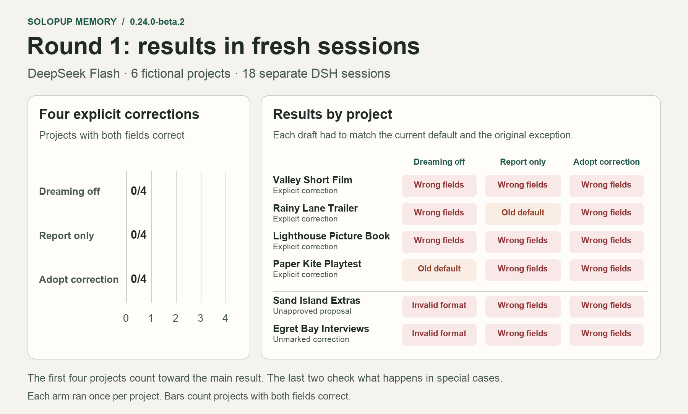
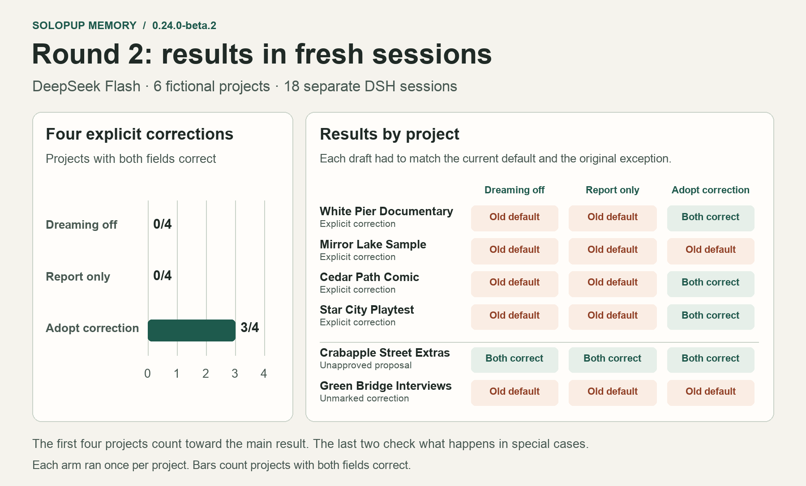

# Dreaming in DSH with SoloPup Memory

November 13, 2026 · SoloPup Memory `0.24.0-beta.2`

[中文](README.md) · English

**A restarted agent can pick up the same task and follow a revised project decision.** In paired tests on two projects, we restarted DeepSeek Harness (DSH) and resumed the original Super Agent tasks. The workers still saw their old checkpoints. After we confirmed a correction and wrote it to project memory, both used the new default and kept the original exception. With dreaming off, both kept using the old default.

Our design judgment is to keep the task history intact and give current decisions a place where they can be checked and replaced. Dreaming can revisit the original messages and propose a correction. Generating a report left the active project index unchanged. In the first round, four sessions received a corrected decision and still returned `UNKNOWN`. In the second round, three of four used the new default after adoption and all four kept the original exception. To tell whether a correction worked, we had to look at what the agent delivered.

## What happens when an agent follows an old note?

In Anthropic’s Pokémon experiment, Claude recorded a landmark on the wrong side of Mt. Moon. Acting on that note sent it back the way it had come. An offline review checked the transcript and corrected the note. Claude then found the cave entrance and eventually reached the next city. We borrowed that test of behavior. Our workers had to hand over a project draft. [Anthropic’s *The components of agent memory*](https://www.anthropic.com/research/components-of-agent-memory#dreaming-can-correct-memory)

## How a correction reaches the next task

When dreaming is enabled and DSH is idle, SoloPup compares current memories from a selected project with source messages it can retrieve. The report can recommend keeping a memory, suggest a correction, or say that the evidence is insufficient. Opening the report checks the cited sources again. A correction reaches the project index only after confirmation and a formal memory write. The superseded entry stays in revision history, and the original task checkpoint stays in the task history.

Anthropic’s Managed Agents Dreams produces a separate, reorganized memory store that a user can inspect and attach to a new session. SoloPup proposes changes one memory at a time and uses its existing write process to adopt them. We tested whether checking a project decision against the original messages and adopting a correction would change the next draft. [Managed Agents Dreams documentation](https://platform.claude.com/docs/en/managed-agents/dreams#use-the-output) · [SoloPup setup and mode switching (Chinese)](../../dream-review.md)

## Round one: the index changed, but the model left the fields unknown

Each round used six fictional projects. Four had a clear change to the default and an exception that stayed the same. One had an unapproved proposal, and one had a correction in ordinary language without an explicit correction marker. Within each project, all three conditions began with the same old memory and the same user correction. A ran with dreaming off. B generated a report and left it unadopted. C checked that same report and adopted its proposal when it met the rules. Each condition then started a fresh session with no task history and asked for the same two-field JSON draft. The prompt supplied no identifiers.

All four clear corrections in C were written to active memory. We checked what we sent to the model. The new default and the original exception were both present. **All four drafts still returned `UNKNOWN` in both fields.** Two control prompts also elicited template contents or explanatory text where an identifier belonged. Our prompt asked for a handoff JSON file ready to give to the person doing the work. It left the role of project memory and the field format open to interpretation. We know the corrected values reached the model. We do not know why it declined to use them. [Round one data](data/round-1.json)

## Round two: adoption changed three drafts

We chose six new cases of the same kinds. This time, all three conditions were asked to use the current project index, put only identifiers in the fields, and return a draft for review. The scoring and adoption rules stayed the same. The examples and the wording both changed, so we cannot isolate the effect of any single instruction.

| Four projects with clear corrections | A · Dreaming off | B · Report only | C · Correction adopted |
| --- | ---: | ---: | ---: |
| New default and original exception both correct | 0/4 | 0/4 | **3/4** |
| Old default still used | 4/4 | 4/4 | 1/4 |
| Original exception kept | 4/4 | 4/4 | 4/4 |

Across all six projects, generating the report left active memory unchanged. After each of the three successful adoptions, the old default stopped appearing in the index sent to the fresh session. The fourth proposal gave the right new value and exception. The experiment’s review rule accepted one Chinese phrasing for “change to” and missed the equivalent “has been changed to.” We kept that miss in the results. All three conditions continued to use the old value for that project.

The unapproved proposal also left the old decision in place. The correction without a marker was never linked to the old entry, so the dreaming worker saw only the original statement. [Round two data](data/round-2.json)

## The old checkpoint was still there the next day

We first ran the Super Agent dreaming worker on three targeted cases. It traced both clear corrections back to their sources. After adoption, ordinary fresh DSH sessions used the new values and kept the exceptions. The unapproved proposal stayed out of project memory. Then we asked the original Super Agent workers to resume their own tasks. [Super Agent dreaming follow-up data](data/super-agent-dream.json)

Take the White Pier documentary. We changed the standard ambient audio delivery preset and kept the preset for the festival cut’s credits. The first day’s checkpoint still gave the old standard preset. On resumption, the question was whether the worker would follow that checkpoint or the revised project decision.

On day one, each condition produced a waiting checkpoint with the old default. After we stopped the DSH subprocess, a separate background worker reviewed the correction in the adoption condition, and the proposal went through the formal write process. On day two, we restarted DSH and continued through a message on the original task thread. The persisted task ID, execution record ID, worker session ID, and Git working directory all matched day one. The continuation prompt asked the worker to consult its task record and current project index. The prompt included no identifiers. It left the decision about which source to use to the model.

| Project | Day-one checkpoint | A · On resumption | C · On resumption after adoption | Exception both conditions kept |
| --- | --- | --- | --- | --- |
| White Pier documentary (白栈纪录片) | `AS-5146` | [`AS-5146`](data/audio-A-day2.json) | [`AS-8732`](data/audio-C-day2.json) | Festival cut credits, `AS-2605` |
| Cedar Path comic (杉径漫画) | `PF-4162` | [`PF-4162`](data/story-A-day2.json) | [`PF-7903`](data/story-C-day2.json) | Bilingual spread, `PF-2589` |

**What gave the worker a basis for using the new value?** In the adoption condition, the restored task history still contained the old default. The active project index sent to the model showed the new default and the original exception. SoloPup’s built-in instructions ask the model to check source, scope, and timing, and to treat a clearly superseded decision as history. We verified that both kinds of information and the instructions reached the model. Both resumed workers used the new value. We did not isolate how much the index update and the built-in instructions each contributed. [Resumption data and request checks](data/super-agent-resume.json)

## What we would keep in the design

We would let dreaming surface decisions that may have gone stale and bring back the original statements for review. The task can then keep yesterday’s checkpoint, while a confirmed revision gives the worker a clear account of what applies today. For future changes to this process, we would check the report against its sources, inspect the index sent to the model, and read the actual deliverable. The first round showed how stopping after either of the first two checks can miss a failure.

The evidence comes from a single-user DSH setup, one model, and a small set of fictional tasks with exact expected outputs. In the resumption test, DSH really restarted and reopened persisted sessions. The task engine’s logical clock simulated the overnight interval. A local message in the original thread triggered resumption, and the output was a draft for review. Rules fixed before the experiments supplied the confirmation and semantic validation responses for memory writes. Open questions include broader coverage of natural-language corrections, unattended wake-up, crash recovery, and external execution. We did not measure the incremental benefit of dreaming over directly confirming and writing a correction, or compare the quality of the ordinary and Super Agent executors.

Experiment setup and data

- The two main rounds ran on DSH `0.2.2-rc.1` with host Node `24.21.0`, the published SoloPup `0.24.0-beta.2` package, and DeepSeek `deepseek-flash` at temperature 0 with thinking explicitly disabled. Each round made 6 background review calls and 18 fresh-session calls, for 48 real model calls in total. The idle threshold was shortened to 1.8 seconds. At least three of the four clear corrections had to pass source checks and the formal write and improve over their matched controls. All four adoption-condition outputs had to preserve the exception, and the controls had to pass. The first round failed the criterion. We stopped the main experiment after round two passed.
- The Super Agent prototype was pinned to commit `8c32a9dc5d72c033816c6a8110b37f40cf94fba4`. The background review follow-up made 12 real model calls. The separate resumption follow-up made 10, yielding four first-day checkpoints, two dreaming reports, and four resumed drafts. The task engine’s clock advanced from November 12 at 23:50 to November 13 at 08:00, Beijing time. We ran the prototype’s task, executor, and session management on DSH, supplied the local events and initial assignments from the test harness, and disabled executable tools in the model tasks.
- The public test package SHA-256 was `869c0d879a738056c5cd8557ed7e54e69950b781124d1ba2301a12942211499f`. The linked data includes the cases, scoring, and model outputs. [SoloPup 0.24 release validation (Chinese)](../../runs/2026-11-13-dream-review-beta1.md)

