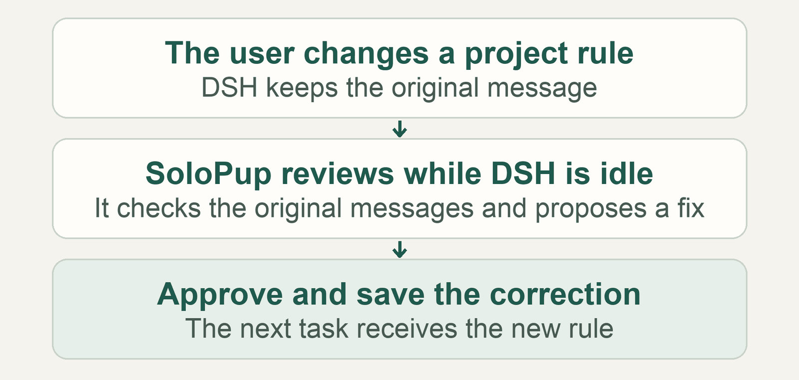
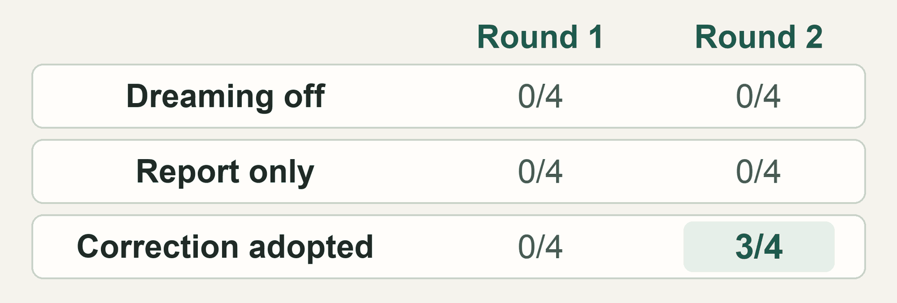
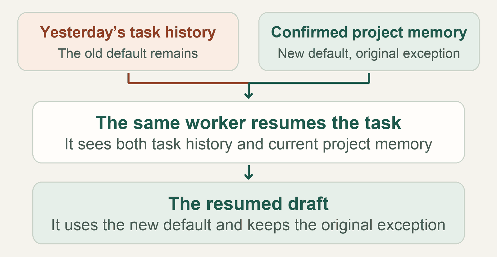

# Dreaming in DSH with SoloPup Memory

November 13, 2026 · SoloPup Memory `0.24.0-beta.2` · [中文](README.md)

Project rules can change halfway through a task. While DeepSeek Harness (DSH), an app for running AI agents, is idle, SoloPup can check saved rules against the original conversation and suggest corrections. We call this **dreaming**. Once you confirm and save the correction, it becomes the project’s current rule.

**In two paired tests, the agent resumed its old task and used the newly confirmed rule.** We restarted DSH and resumed the tasks with Super Agent, a prototype for running long-lived tasks. Both drafts used the new default and kept the original exception. The agent could still see its old progress notes. With dreaming off, both drafts used the old default.

*Figure 1. Idle review proposes a change. Confirmation makes it part of the project memory the agent receives.*

## How a correction reaches the agent

When dreaming is enabled for a project, SoloPup checks saved decisions against messages it can retrieve. The report can recommend keeping a decision, suggest a correction, or flag a lack of evidence. Opening the report checks the cited messages again. A confirmed revision then goes through the regular memory write process and replaces the old entry in the list of current project rules. The old entry stays in revision history. The agent’s saved task progress stays where it was. [SoloPup setup and mode switching (Chinese)](../../dream-review.md)

We took our cue from an Anthropic experiment in which Claude played Pokémon. Claude saved a landmark on the wrong side of Mt. Moon and backtracked after relying on the note. Once an idle review checked the transcript and corrected the note, Claude found the cave entrance and eventually reached the next city. We looked for a similar change in what the agent produced. Anthropic’s Managed Agents Dreams creates a separate memory store that users can inspect and attach to a later session. SoloPup proposes individual changes that users can confirm and save in their existing project. [Anthropic’s *The components of agent memory*](https://www.anthropic.com/research/components-of-agent-memory#dreaming-can-correct-memory) · [Managed Agents Dreams documentation](https://platform.claude.com/docs/en/managed-agents/dreams#use-the-output)

## What changed in a fresh session?

We compared three conditions for each fictional project. All three started with the same saved rule and heard the same user correction.

| Condition | What happened before the next session |
| --- | --- |
| A · Dreaming off | The old rule stayed in project memory. |
| B · Report only | SoloPup wrote a report and left project memory as it was. |
| C · Correction adopted | We reviewed B’s report and saved its proposal if it passed the preset checks. |

Each condition opened a fresh session with no task history and asked for the same handoff draft with two fields, the current default and the original exception. The prompt gave no reference codes. Each round had four projects with explicit corrections, one with an unapproved proposal, and one with a correction stated in ordinary language without a marker.

### Round one: the new rule reached the model, and all four drafts came back unknown

All four explicit corrections passed review and went into project memory. We checked the requests sent to the model. Every request in C contained both the new default and the original exception. Every draft still said `UNKNOWN` in both fields.

The request asked for a handoff ready to pass to the person doing the work. It left room for interpretation about which information to use and what belonged in each field. On two control questions, the model supplied template text or explanations where a code belonged. We could verify that the corrected values reached the model. The reason it left the fields unknown remains unclear. [Round one data](data/round-1.json)

### Round two: three drafts used the correction

We picked six new cases of the same kinds. We asked all three groups to fill a draft for review using the current project rules, with only a code in each field. We kept the same scoring and review rules.

*Figure 2. The chart counts drafts that used the new default and kept the original exception. All three groups kept all four original exceptions in round two.*

Generating a report left project memory unchanged in all six projects. The fourth proposed correction was accurate, but our review rule missed one way of saying “changed to” in Chinese. We counted that case as a miss. All three conditions used the old default. The unapproved proposal also left the old rule in place. In the case without a correction marker, the new message never got linked to the old rule, so the review saw only the original statement. Both the cases and the prompt changed between rounds, which leaves the effect of the wording on its own open. [Round two data](data/round-2.json)

## The old checkpoint was still there the next day

The fresh-session tests showed what happens when a new session receives a correction. We wanted to see what happens when the agent reopens a task that still carries the old rule.

In the fictional White Pier documentary, we changed the standard preset for delivering ambient audio and kept the separate preset for the festival cut’s credits. The agent’s first-day progress note, or checkpoint, still listed the old standard preset. We first checked the optional Super Agent background reviewer on three cases. It found the source of both explicit corrections and left an unapproved proposal out of project memory. Ordinary DSH sessions used both corrections after we saved them. Then we resumed the original Super Agent tasks. [Super Agent review data](data/super-agent-dream.json)

Each group started with a saved task and a checkpoint containing the old default. We stopped DSH. In the correction group, a separate background worker checked the source messages and the proposal went through the regular write process. We restarted DSH and sent a follow-up in the original task thread. We verified that the task, execution record, worker session, and Git working directory all matched day one. The follow-up asked the agent to consult its task record and current project rules. It gave no codes and left the choice between the two sources to the agent.

The request the agent received still contained the old checkpoint. The current project rules in that same request showed the new default and the original exception. SoloPup’s built-in guidance tells the model to check a rule’s source, scope, and timing and to treat a superseded rule as history. We verified that the guidance and both sets of information reached the model.

*Figure 3. The worker could still see the old default in its progress note. Both resumed tasks used the new default after we saved the correction.*

| Project | Old checkpoint | Dreaming off | Correction adopted | Exception both groups kept |
| --- | --- | --- | --- | --- |
| White Pier documentary | `AS-5146` | [`AS-5146`](data/audio-A-day2.json) | [`AS-8732`](data/audio-C-day2.json) | Festival cut credits, `AS-2605` |
| Cedar Path comic | `PF-4162` | [`PF-4162`](data/story-A-day2.json) | [`PF-7903`](data/story-C-day2.json) | Bilingual spread, `PF-2589` |

The two comparisons show that an agent can keep its old progress note and follow a revised project rule. We tested the updated memory and SoloPup’s built-in guidance together. Their individual contributions remain open. [Resumption data and request checks](data/super-agent-resume.json)

## What we learned

Keep a record of what the agent did, and keep an up-to-date record of which rules apply. Dreaming helps find a stale rule and bring the original messages back for review. After confirmation, we check the agent’s draft to see whether it followed the revision. The first round showed how much we would miss by checking the report or the request alone.

These tests used one model, a single-user DSH setup, and a small set of fictional projects scored against exact answers. We restarted DSH and reopened real saved sessions. The task engine’s clock simulated the overnight interval, and a local follow-up in the original thread resumed each task. The agent produced a draft for review. We used fixed rules to simulate user confirmation and the model’s validation of memory writes. The tests leave open unattended wake-up, crash recovery, external actions, and broader coverage of unmarked corrections. We also did not measure the additional benefit of dreaming over confirming and saving a correction directly, or compare the quality of the ordinary and Super Agent executors.

Experiment setup and data

[Detailed test setup](assets/architecture-en.png) · [Round one by project](assets/round-1-en.png) · [Round two by project](assets/round-2-en.png)

- The main rounds ran on DSH `0.2.2-rc.1` with host Node `24.21.0`, the published SoloPup `0.24.0-beta.2` package, and DeepSeek `deepseek-flash` at temperature 0 with thinking explicitly disabled. Each round made 6 background review calls and 18 fresh-session calls, for 48 real model calls in total. The idle threshold was 1.8 seconds for testing. The preset success criteria required at least three of the four explicit corrections to pass source checks and the formal write and improve over their matched controls. All four drafts in C had to keep the exception, and the controls had to pass. Round one fell short. We ended the main experiment after round two met the criteria.
- The Super Agent prototype was pinned to commit `8c32a9dc5d72c033816c6a8110b37f40cf94fba4`. The background review test made 12 real model calls. The resumption test made 10 more, yielding four first-day checkpoints, two dreaming reports, and four resumed drafts. The task engine’s clock advanced from November 12 at 23:50 to November 13 at 08:00, Beijing time. We ran the prototype’s task, executor, and session management on DSH. The test harness supplied local events and initial assignments, and the model had no executable tools in the task.
- The public test package SHA-256 was `869c0d879a738056c5cd8557ed7e54e69950b781124d1ba2301a12942211499f`. The data linked above includes cases, scoring, and model outputs. [SoloPup 0.24 release validation (Chinese)](../../runs/2026-11-13-dream-review-beta1.md)

