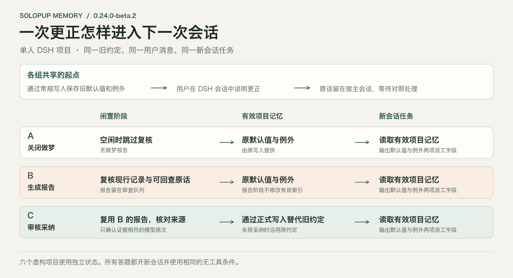
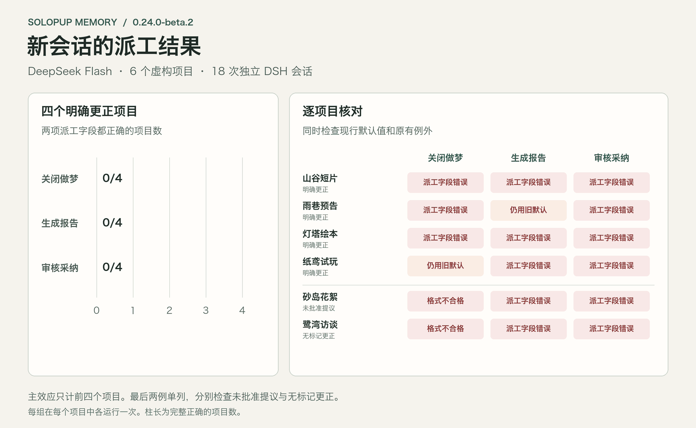
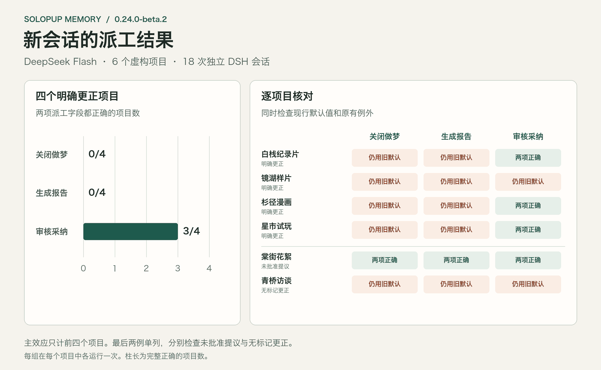

# Anthropic 的做梦方式在 DSH 记忆插件里的实现

2026 年 11 月 13 日 · SoloPup Memory `0.24.0-beta.2`

中文 · [English](README.en.md)

**项目约定改了，Super Agent 恢复原任务时可以用上新约定，昨天的记录仍然可查。** 我们在真实 DSH 里对两个项目做了跨天恢复对照。重启后，Worker 都看到了昨天保存的任务进度。正式采纳做梦建议后，两个任务都按新约定填写常规项目，也保留了原来的例外。关闭做梦时，两个任务都沿用了旧约定。

这里的「做梦」指 DSH 闲置时回查用户原话，找出可能过时的约定，提出供人核对的更正。只生成报告的组仍然读到旧约定。

**我们的结论是，保留任务历史，单独更新经过确认的项目约定，并用下一次交付验证它有没有被采用。** 第一轮四条更正都已写入并传给模型，四份草稿却全答了「不知道」。第二轮换了同类案例，也把任务说明说得更清楚，采纳组四份草稿有三份用上了新约定。

## 一条错笔记能把 Agent 带到哪里？

Anthropic 用 Pokémon 里的月见山来回答这个问题。Claude 把一个地标记到了山洞的错误一侧，后来照着笔记走，又掉回了来时的路。离线复核回查原始对话、纠正笔记后，Claude 改走山洞入口，最后到达下一座城市。它用实际走到哪里判断记忆有没有帮上忙。我们借用了这个检验方法，把山洞换成了项目交接。 [Anthropic《The components of agent memory》](https://www.anthropic.com/research/components-of-agent-memory#dreaming-can-correct-memory)

## 我们把报告和现行约定分开

开启做梦后，SoloPup 在 DSH 闲置时，拿选定项目的现行记录与可回查的用户原话做比较。报告会给出保留、建议更正或证据不足的判断。打开报告时，插件会再核对引用的来源。只有经过确认和正式写入，修订才进入后续任务读取的项目索引。旧条目保留在修订历史中，原任务的检查点也保留。

Anthropic 的 Managed Agents Dreams 会交付一份独立的重组记忆库，用户可以检查后挂到新会话。SoloPup 把复核做成逐条建议，采纳沿用原有的写入流程。我们关注的是其中一个用途：用原话修正一项约定，然后观察它是否改变下一次产出。 [Managed Agents Dreams 文档](https://platform.claude.com/docs/en/managed-agents/dreams#use-the-output) · [SoloPup 开启与切换指南](../../dream-review.md)

## 第一轮，我们更新了记忆，模型没填表

两轮都用六个虚构项目。其中四个明确改了默认值，但保留原例外。另两个检查未批准的提议，以及未使用显式更正格式的自然语言决定。同一项目的三个条件从同样的旧记忆和用户更正出发。A 关闭做梦，B 只生成报告，C 核对同一份报告，符合规则才正式采纳。每组开一个无历史的新会话，交付同样的两字段 JSON 草稿，题面不提供编号。

第一轮的四条更正全部进入正式记忆。我们检查了发给模型的请求，新值和原例外都在。**采纳组的四份草稿却把两个字段全填成了 `UNKNOWN`。** 还有两道控制题，模型把模板内容或说明文字塞进字段。我们原来要求生成「可直接交给执行人的派工 JSON」，对可用的项目记忆和字段格式说得不够明确。新值确实到了模型那里。我们仍不知道它为什么弃答。 [首轮逐项数据](data/round-1.json)

## 第二轮，采纳改变了三份草稿

我们换了六个同类案例，要求三组都用当前项目索引填一份供人核对的草稿，字段只填编号。评分门槛和采纳规则照旧。由于题目也换了，这两轮无法单独测出是哪句提示起了作用。

| 四个明确更正项目 | A · 关闭做梦 | B · 仅报告 | C · 审核采纳 |
| --- | ---: | ---: | ---: |
| 新默认和原例外都正确 | 0/4 | 0/4 | **3/4** |
| 仍用旧默认 | 4/4 | 4/4 | 1/4 |
| 保留原例外 | 4/4 | 4/4 | 4/4 |

六个项目里，报告生成前后的有效记忆一致。三次正式采纳之后，旧默认退出了新会话的有效索引。第四条建议给出的新值和例外都正确，但实验审核规则接受「改为」，漏掉了「已改为」。我们保留了这次漏判，三个条件都继续使用旧值。未批准的提议也保留了旧约定。没有显式标记的自然语言更正则没有关联到旧条目，做梦时只看到最初的原话。 [第二轮逐项数据](data/round-2.json)

这轮结果给出了一个实际的界线。**报告能指出该改什么，正式采纳才能改变模型读到的当前约定。** 首轮也说明，即使索引已经更新，模型仍可能没有用上它。

## 第二天，旧检查点还在

我们先让真实 Super Agent 做梦 Worker 跑过三个定向案例。两个明确更正都能回查原话，正式采纳后，普通 DSH 新会话使用新值、保留例外。未批准的提议没有写入。接着我们让 **原来的 Super Agent Worker** 恢复任务。 [Super Agent 做梦补测数据](data/super-agent-dream.json)

白栈纪录片是一个虚构的交接项目。我们把常规环境声的交付预设换成了新版，展映版片尾继续用原来的预设。杉径漫画也做了同类更正，更新了默认校对反馈表，保留双语对照页的例外。

第一天，两组都用旧编号生成等待检查点。关掉 DSH 子进程后，采纳组由另一个后台 Worker 复核并经正式流程更新约定。第二天，两组都重新启动 DSH，由同一任务线程收到续做消息。我们核对了磁盘上的任务和 DSH 会话，原任务、执行记录、Worker 会话和 Git 工作目录都延续下来。续做消息要求结合任务记录和当前项目索引填草稿，里面没有任何编号，也没有指定冲突时哪边优先。

| 项目 | 旧检查点 | A · 恢复后使用 | C · 采纳后恢复使用 | 两组保留的例外 |
| --- | --- | --- | --- | --- |
| 白栈纪录片 | `AS-5146` | [`AS-5146`](data/audio-A-day2.json) | [`AS-8732`](data/audio-C-day2.json) | 展映版片尾 `AS-2605` |
| 杉径漫画 | `PF-4162` | [`PF-4162`](data/story-A-day2.json) | [`PF-7903`](data/story-C-day2.json) | 双语对照页 `PF-2589` |

**为什么 Worker 有依据用新值？** 采纳后，旧默认仍在恢复出来的任务历史里，发给模型的有效项目索引则只列新默认和原例外。SoloPup 自带的冲突指引要求核对来源、范围与时间，并把已明确更正的内容当作历史。我们在实际请求中看到这两类信息和产品指引同时存在，两个 Worker 都采用了新值。实验没有拆开测索引更新和冲突指引各自贡献了多少。 [跨天逐项数据与请求核对](data/super-agent-resume.json)

## 这改变了我们对做梦的判断

我们愿意让做梦在后台找出可能过时的决定，把原话拿回来给人核对。保留昨天的检查点，让任务还能接着做。把今天的有效约定单独更新，让 Worker 有据可依。今后验收修订，我们会看完实际交付。首轮四份全填 UNKNOWN 的草稿提醒我们，在报告或索引处停下来，会漏掉实际失败。

这份证据来自单人 DSH、一个模型和少量可精确评分的虚构任务。跨天测试用了真实的进程重启和持久会话，夜间间隔由任务引擎的逻辑时钟模拟。恢复由本地同线程消息触发，输出是供人核对的草稿。确认和正式写入的语义验证应答由冻结规则驱动。自然语言更正的覆盖、无人值守唤醒、崩溃恢复和外部执行还有待验证。实验也没有测出做梦相对于直接确认写入的额外收益，或比较普通执行器和 Super Agent 谁更好。

实验设置与数据

- 两轮主对照使用实际 DSH `0.2.2-rc.1`、宿主 Node `24.21.0`、公开的 SoloPup `0.24.0-beta.2` 和 DeepSeek `deepseek-flash`，温度 0，显式关闭思考。每轮 6 次后台复核、18 次新会话，共 48 次真实模型请求。闲置门槛缩短到 1.8 秒。四个明确更正项目中，至少三个须完成证据核对、正式写入和配对改善，四个采纳组产物都须保留例外，控制项也须通过。首轮失败，第二轮通过后停止主对照。
- Super Agent 使用原型提交 `8c32a9dc5d72c033816c6a8110b37f40cf94fba4`。后台复核补测共 12 次真实模型请求。跨天补测另有 10 次，含四份首日检查点、两份做梦报告和四份恢复草稿。原型任务引擎时钟从北京时间 11 月 12 日 23:50 前进到 11 月 13 日 08:00。原型的任务、执行器和会话管理使用真实 DSH，本地事件来源和初次分派由测试驱动，模型任务关闭可执行工具。
- 公开测试包 SHA-256 为 `869c0d879a738056c5cd8557ed7e54e69950b781124d1ba2301a12942211499f`。案例、评分与模型输出见各节数据。产品的发布验收另有记录。 [0.24 发布验收](../../runs/2026-11-13-dream-review-beta1.md)

