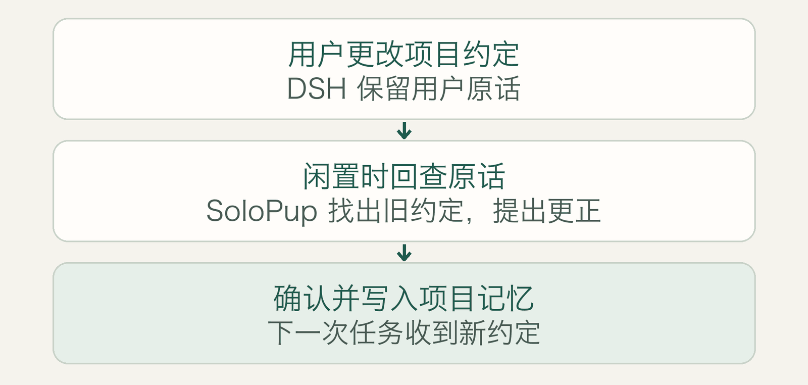
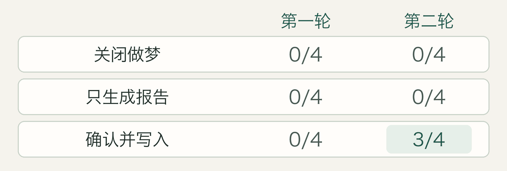
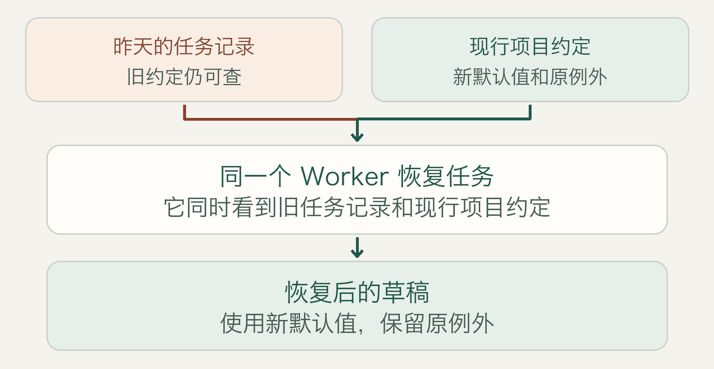

# 让 Super Agent 用上新约定：SoloPup 做梦实验

2026 年 11 月 13 日 · SoloPup Memory `0.24.0-beta.2` · [English](README.en.md)

项目约定改了，AI 接着昨天的任务做时，还会沿用旧版本吗？DeepSeek Harness（DSH）是一款运行 AI 助手的工具。记忆插件 SoloPup 的「做梦」会在 DSH 闲置时回看原话，找出可能过时的项目约定，提出更正。你确认并保存后，新约定才生效。

**在两个跨天恢复对照中，AI 都保留了昨天的任务记录，同时用上了新约定。** 我们重启 DSH，让它的长任务原型 Super Agent 恢复原任务。确认更正后，两例都用了新默认值、保留原例外。关闭做梦时，两例都沿用了旧默认值。

*图 1. 做梦负责找出该改哪一条。确认并写入后，下一次任务才会收到新约定。*

## 做梦怎样改正一条记忆？

Anthropic 在 Pokémon 里遇到过一个相似问题。Claude 把地标记在山洞的错误一侧，照着笔记走，又掉回了来路。闲时复核用原始对话纠正笔记后，Claude 改了路线，最后到了下一座城市。我们借用了同一个检验方法，直接看纠正记忆后 AI 交出了什么。 [Anthropic 原文](https://www.anthropic.com/research/components-of-agent-memory#dreaming-can-correct-memory)

SoloPup 对照的是某个项目的当前约定和用户原话。它可以建议保留、提出更正，也可以指出证据不足。打开报告时，插件会再次核对来源。Anthropic 的 Managed Agents Dreams 可以产出一份单独的记忆库，供用户检查后挂到新会话。SoloPup 则让人逐条核对建议，确认后用原有的记忆写入流程更新项目约定。旧条目仍可在修订历史里查到。 [Managed Agents Dreams 文档](https://platform.claude.com/docs/en/managed-agents/dreams#use-the-output) · [SoloPup 开启指南](../../dream-review.md)

## 首轮：四条更正都写进去了，四份草稿却没用上

我们做了两轮对照，每轮六个虚构项目。其中四个明确换了常规做法，需要保留原有例外。另两个用来观察未批准的提议和没有按格式标明的更正。每个项目都用相同的旧约定和更正消息开三组。

| 条件 | 下一次会话开始前 |
| --- | --- |
| A · 关闭做梦 | 保留旧约定 |
| B · 仅生成报告 | 生成报告，旧约定继续生效 |
| C · 采纳更正 | 核对 B 的报告，符合规则才写入 |

每组随后打开新会话，填一份只有两个字段的交接草稿。题面不提供编号，草稿要自己写出常规和例外分别用哪一项。

第一轮，C 组四条更正全部写入。我们检查了模型收到的内容，新默认和原例外都在。**四份草稿却把两栏都填成了 `UNKNOWN`。** 另外两道控制题也出现了把模板说明填进编号栏的情况。原来的任务说明没说清可用哪些项目记录、字段该怎么填。我们能确认新约定已经送达，仍不清楚模型为什么弃答。 [首轮逐项数据](data/round-1.json)

## 第二轮：采纳更正后，三份草稿用了新约定

我们换了六个同类案例，请三组都用当前项目记忆填写一份供人核对的草稿，每栏只填编号。评分和采纳规则照旧。案例和题面一起换了，无法单独判断哪一句说明改变了结果。

*图 2. 只计每轮四个明确更正的项目。两栏都正确才计入。第二轮三组的四个原例外都保留了。*

第二轮关闭做梦和仅生成报告的两组都沿用了四个旧默认值。采纳组有三份草稿用上新值。剩下那条建议给对了编号和例外，但实验的审核规则接受「改为」，漏掉了「已改为」，因此没有写入。未批准的提议也没有写入。那条没加更正标记的消息没有连到旧条目，后台只看到了最初的原话。 [第二轮逐项数据](data/round-2.json)

## 第二天，旧检查点还在

白栈纪录片换了常规声音交付预设，展映版片尾沿用原方案。杉径漫画换了常规校对反馈表，双语对照页保留原表。我们想知道，**同一个 Worker（负责执行任务的 AI）恢复原任务时，会怎么用昨天的记录和今天的约定？**

两组第一天都保存了用旧约定做事的进度。随后我们关掉 DSH 进程，在采纳组由另一个后台 Worker 做梦复核并更新项目记忆。第二天重启后，我们从原任务线程发送相同的续做消息。它没有给编号，也没有告诉模型遇到冲突该听哪一边。任务、执行记录、Worker 会话和 Git 工作目录都和第一天一致。

两组都收到了昨天保存的旧记录。采纳组还收到了只列新默认和原例外的现行项目记忆。SoloPup 自带的指引要求根据来源、范围和时间区分历史记录与当前约定。

*图 3. 采纳组实际收到的两类信息。任务历史保留旧值，现行项目记忆提供新值。*

| 项目 | 昨天的任务记录 | 关闭做梦，恢复后使用 | 采纳更正，恢复后使用 | 两组保留的例外 |
| --- | --- | --- | --- | --- |
| 白栈纪录片 | `AS-5146` | [`AS-5146`](data/audio-A-day2.json) | [`AS-8732`](data/audio-C-day2.json) | 展映版片尾 `AS-2605` |
| 杉径漫画 | `PF-4162` | [`PF-4162`](data/story-A-day2.json) | [`PF-7903`](data/story-C-day2.json) | 双语对照页 `PF-2589` |

两个采纳组 Worker 都用了新默认值。我们核对过模型收到的信息和它交回的草稿。现有对照支持这套做法，索引更新和冲突指引分别贡献了多少，还没有测。此前另做了三个后台 Worker 兼容性测试，核对它能否生成报告、回查来源和正式写入。 [跨天恢复数据](data/super-agent-resume.json) · [后台 Worker 补测](data/super-agent-dream.json)

## 我们会保留怎样的记忆设计？

**保留任务历史，单独更新经过确认的项目约定。** 昨天的记录能告诉 Agent 做到了哪一步。今天的约定能告诉它接下来怎么做。第一轮让我们看到，报告写对、项目记忆更新、模型实际采用，是三次不同的检查。验收要看到最后一份交付。

实验只用了单人 DSH、一个模型和少量可精确评分的虚构项目。我们实际重启了 DSH，用任务引擎的时钟模拟跨夜，再从同一任务线程发消息继续。交付是供人核对的草稿，确认和写入验证由预先固定的实验规则模拟。我们还不知道这一结果能否扩展到无人值守唤醒、崩溃恢复或外部执行。对比直接确认写入，做梦额外带来多少收益，也尚未测量。

实验设置、逐项图和数据

- 两轮主对照使用 DSH `0.2.2-rc.1`、宿主 Node `24.21.0`、公开包 SoloPup `0.24.0-beta.2` 和 DeepSeek `deepseek-flash`，温度 0，关闭思考。每轮 6 次后台复核和 18 次新会话，共 48 次真实模型调用。闲置门槛缩到 1.8 秒。四个明确更正项目至少三个须完成证据核对、正式写入并胜过配对对照。四份采纳组草稿都须保留例外，控制项也须通过。首轮未通过，第二轮通过后停止主实验。
- Super Agent 使用原型提交 `8c32a9dc5d72c033816c6a8110b37f40cf94fba4`。后台复核补测 12 次真实调用，跨天恢复另有 10 次，包含四份首日检查点、两份报告和四份恢复草稿。任务引擎从北京时间 11 月 12 日 23:50 前进到 11 月 13 日 08:00。原型任务、执行器和会话管理在真实 DSH 上运行，本地事件和初次分派由实验驱动，模型任务关闭可执行工具。
- 公开包 SHA-256 为 `869c0d879a738056c5cd8557ed7e54e69950b781124d1ba2301a12942211499f`。 [0.24 发布验收](../../runs/2026-11-13-dream-review-beta1.md)
- [三组实验结构图](assets/architecture.png) · [首轮逐项图](assets/round-1.png) · [第二轮逐项图](assets/round-2.png)

