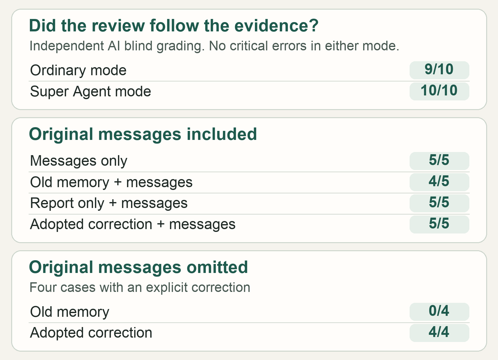
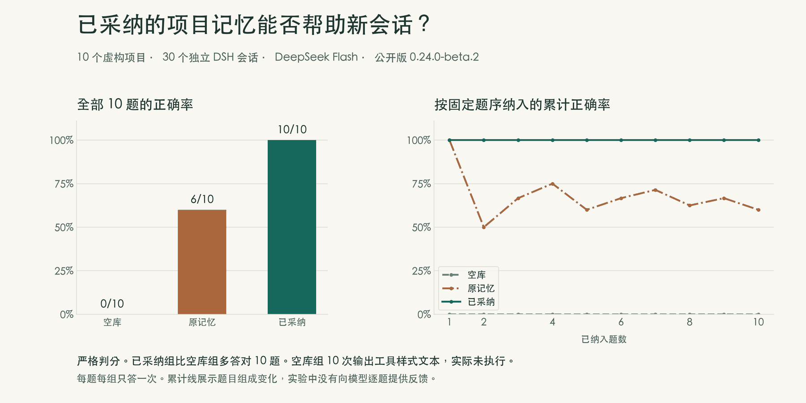
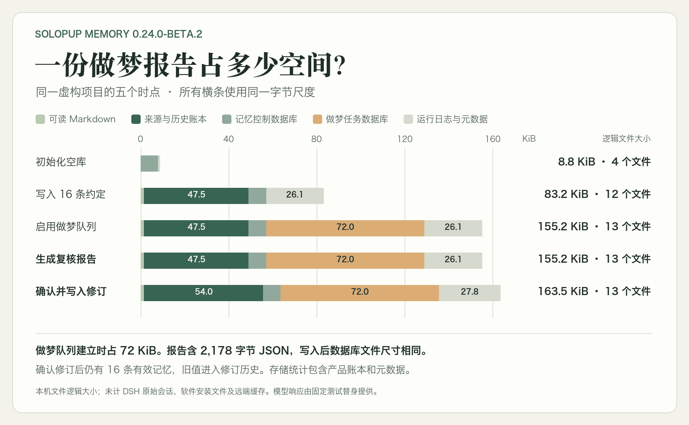

# SoloPup dreaming study: the full comparisons

[Back to the study](README.en.md) · [中文](SCIENCE.md)

We first tested whether a dream report could tell when a project rule had really changed. Then we checked which rule the model used in a fresh session after a correction was confirmed and saved. Both steps failed at different points. This page records the prerelease trials, the follow-up comparisons on the published beta, and the storage measurement. The two rounds in the [main article](README.en.md) used their own cases and scoring.

## Review met the preset bar after two failed attempts

We gave ordinary DSH and Super Agent the same fictional project evidence and the same DeepSeek Flash model, with thinking off and no tools. We fixed ten cases and a rubric before the trial. Automatic checks examined output structure and citations. An independent AI reviewer judged the meaning without knowing which mode produced each answer. The bar was at least 9/10 and zero critical errors per mode.

- At first, both modes treated “the old template expired and a new one has yet to be approved” as enough to propose a replacement. Super Agent also missed some source citations, so validation rejected its result. We stopped after the first batch.
- The first revision asked the model to distinguish an expired rule from a confirmed replacement. Both modes still proposed revisions where a replacement was undecided. Ordinary DSH also recommended keeping a rule despite incomplete evidence.
- The next revision put the evidence check first, followed by the question of whether the new rule was explicit. Both modes completed all cases and passed the automatic checks at 10/10. The blind semantic review scored ordinary DSH **9/10** and Super Agent **10/10**, with zero critical errors in either mode. The ordinary mode lost one point for attributing a user's paraphrase to the Worker. Its decision and scope were still correct.
- We repeated two held-out cases on the final archive after fixing token accounting. Both modes scored **2/2**, with zero critical errors. Both omitted a same-day restriction in the explanation, while keeping the internal sample format separate from the external delivery rule.

The ten-case blind review used the beta.1 archive from before the accounting fix. The final beta.1 archive repeated the held-out cases. An AI reviewer performed the blind scoring, and the sample is too small to rank the executors. The full prerelease pilot made 40 real model calls, including failures, reruns, accounting checks, and the next-session tests below. [Blind review scores](data/blind-review-summary.json) · [Release validation and archive details](../../runs/2026-11-13-dream-review-beta1.md)

*Overview. The first panel scores reports. The second scores answers to five questions with the same excerpts. The third shows only the four changed-rule questions from a separate test without excerpts.*

## When the prompt includes the original messages, how much does the correction add?

We ran the same five questions in four fresh-session conditions, for 20 real model calls. We put the same relevant excerpts directly into the prompt for each condition and asked the model to answer from them and cite them.

| Condition | Blind semantic score |
| --- | ---: |
| Excerpts only | 5/5 |
| Old memory and excerpts | 4/5 |
| Report only, with excerpts | 5/5 |
| Saved correction and excerpts | 5/5 |

On the key question we chose in advance, both the old-memory and saved-correction groups read in the excerpts that the default language had changed from Chinese to English. We required the first group to miss that question and the second to get it right. Both answered correctly, and the excerpts-only group got all five questions right. The old-memory group made one unsupported inference on another question. The report-only group received identical injected memory and answered that question correctly. We cannot attribute that single difference to saving the correction. These results describe accuracy when the relevant excerpts are already in the prompt.

We asked the same language question in a separate check without excerpts, using a different answer format and rubric. The old-memory and report-only sessions chose Chinese. The session with the saved correction chose English. The first two sessions received identical injected memory. The report-only answer gave the old value, Chinese, in a full sentence and also failed the one-word format check. [Four-condition scores](data/source-excerpt-summary.json) · [One-question check and validation notes](../../runs/2026-11-13-dream-review-beta1.md)

## Ten projects tested in fresh sessions

We froze ten fictional projects for the published `0.24.0-beta.2` package and ran each question in three conditions, for 30 real model calls. The conditions were an empty store, the old memory, and an adopted correction. Each used the same plugin and question, with no conversation excerpts, tools, or feedback between questions. Corrections went through the product's write interface, and the harness supplied the source-review responses. We used DeepSeek with thinking off, temperature 0, and a 160-token output cap. The macOS host ran DSH `0.2.2-rc.1` with Node `24.21.0`.

| Cases | Empty store | Old memory | Adopted correction |
| --- | ---: | ---: | ---: |
| Rule unchanged | 0/4 | 4/4 | 4/4 |
| Rule changed | 0/4 | 0/4 | 4/4 |
| Insufficient evidence, expected `UNKNOWN` | 0/2 | 2/2 | 2/2 |
| Strict score | **0/10** | **6/10** | **10/10** |

*Figure 1. On all four changed-rule questions, the old-memory sessions gave the old code and the sessions with saved corrections gave the new one. The running curve reflects the order in which questions were counted. The model got no feedback from one question to the next.*

The two-sided exact test for the four changed-rule pairs gave `p=0.125`. Every empty-store response resembled a tool call, six resembling `bash` and four resembling `memory_search`. No tool ran. This formatting failure lowered the strict score, so 0/10 tells us little about ordinary DSH use without memory.

We reran just the two insufficient-evidence questions with the same rubric. We explicitly said that tools were unavailable and to answer `UNKNOWN` if the evidence was missing. Each condition ran twice. **All six abstained correctly**, and none produced tool-shaped text. The full ten-question scores above still stand. Together the two tests used 36 real model calls, 68,018 input tokens, and 598 output tokens. [Ten-question results](data/paired-return.csv) · [Six abstention reruns](data/abstention.csv)

## A report left the active index byte for byte the same

We wrote 16 fictional memories to an empty store, set up the dream queue, generated a report with five suggestions, and adopted one correction. The workload used the production write interface, review runtime, and SQLite queue, with scripted host events and model responses. Two independent runs produced the same apparent file sizes.

| Checkpoint | Apparent bytes | Active memories |
| --- | ---: | ---: |
| Empty store | 9,047 | 0 |
| After 16 writes | 85,185 | 16 |
| After setting up the dream queue and pointers | 158,913 | 16 |
| After generating the report | 158,913 | 16 |
| After adopting one correction | 167,428 | 16 |

*Figure 2. Setting up the queue wrote a 73,728 B SQLite file. The 2,178 B report fit in existing pages, so apparent size stayed the same. Adoption kept 16 memories active and added one superseded entry to history.*

We summed file lengths under `memory/`, `memory.control/`, and `memory.dream/`. Host conversation logs, program files, and provider caches were outside the measurement. The two runs reproduced these figures for one workload. Long-run growth remains unmeasured. [Storage data](data/storage-footprint.csv)

Separate host checks covered idle dispatch, source verification, switching both ways between ordinary DSH and Super Agent, upgrades, and rollback. Those checks cover runtime behavior in the tested environment. The real-model comparisons above cover answers and judgments on a limited set of tasks. [Release validation](../../runs/2026-11-13-dream-review-beta1.md)
