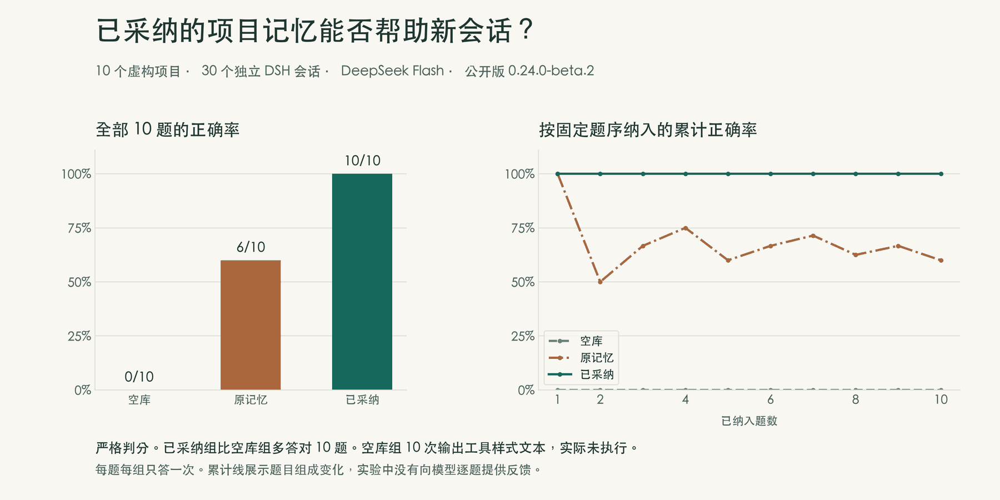
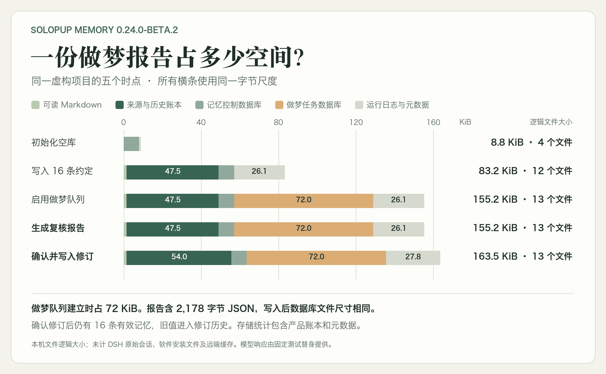

# SoloPup 做梦实验的完整对照

[回到研究报告](README.md) · [English](SCIENCE.en.md)

我们先检验做梦报告能否判断一条规则是否真的变了，再检验人确认并写入更正后，模型在下一次会话里会用哪条规则。这两步曾分别失败。下面保留了预发布试验、公开版补充对照和存储测量的结果。主报告的两轮实验另有自己的样本和计分，见[正文](README.md)。

## 两次失败之后，复核才达到预设门槛

同一批虚构项目证据、同一个真实 DeepSeek Flash 模型、关闭思考且不提供工具。普通模式和 Super Agent 模式分别作答。试验前冻结十个案例和评分表，先核查输出结构及引证，再由不知道模式的独立 AI 评阅者核查语义。每种模式的门槛为至少 9/10 且零关键错误。

- 最初，两种模式都把「旧模板已到期，新模板还没确认」当成已有替代方案。Super Agent 还漏引了部分原始出处，结果被校验器拒绝。本轮在首批结束后停止。
- 第一次调整要求区分旧规则失效与新规则已经确定。两种模式仍在替代值未定时建议修改。普通模式还在证据不完整时建议保留。
- 第二次调整把检查证据完整性放到前面，再判断是否已有明确的新约定。两种模式均完成全部案例，自动核对均为 10/10。匿名语义评分为普通 **9/10**、Super Agent **10/10**，均无关键错误。普通模式有一例把用户转述的原话归给了 Worker，采用的规则和适用范围仍正确。
- 最终计量修复归档重跑两道留出题，两个模式均为 **2/2**、零关键错误。两种模式都漏写了一处仅限当天的条件，未将试样格式推广成外发约定。

十例盲评分使用计量修复前的 beta.1 归档，最终 beta.1 归档复跑了留出题。评阅是 AI 盲评，样本不足以比较两个执行器谁更可靠。早期完整试点含 40 次真实模型调用，包含失败、重试、计量验证和下文回读测试。 [盲评汇总](data/blind-review-summary.json) · [0.24 发布验收与归档信息](../../runs/2026-11-13-dream-review-beta1.md)

## 给了原话，修订记忆还有多少帮助？

同五道题分别跑四组全新会话，共 20 次真实模型请求。四组都能看到相同的原话摘录。

| 条件 | 匿名语义评分 |
| --- | ---: |
| 仅原话 | 5/5 |
| 旧记忆＋原话 | 4/5 |
| 仅报告、未采纳＋原话 | 5/5 |
| 正式采纳的修订＋原话 | 5/5 |

预先指定的语言更正题里，旧记忆组与已采纳组都根据原话答对，**预设的改善判据未通过**。旧记忆组另有一次误推断，但仅报告组收到的记忆注入与它相同，并在同题答对。单次差异无法归因于采纳。

另取一道语言题，去掉历史原话，用三个独立新会话作答。旧记忆、仅报告、正式采纳三组依次采用中文、中文、英文。前两组的记忆注入完全一致。仅报告组用整句表达中文，含义正确但未通过严格的一词格式评分。 [四组判分汇总](data/source-excerpt-summary.json) · [单题回读与验收记录](../../runs/2026-11-13-dream-review-beta1.md)

## 十个项目的新会话回读

公开包 `0.24.0-beta.2` 的实验冻结了十个虚构项目。每题跑空库、原记忆、已采纳三组，共 30 次真实模型请求。三组安装同一插件，用同样的题面，无历史原话、无工具、无逐题反馈。正式修订通过产品写入接口，来源审查应答由测试程序提供。模型为 DeepSeek，关闭思考，温度为 0，每次最多生成 160 token。DSH 宿主为 macOS `0.2.2-rc.1`，使用 Node `24.21.0`。

| 场景 | 空库 | 原记忆 | 正式采纳 |
| --- | ---: | ---: | ---: |
| 约定没变 | 0/4 | 4/4 | 4/4 |
| 约定已经更改 | 0/4 | 0/4 | 4/4 |
| 当前事项证据不足，应答 `UNKNOWN` | 0/2 | 2/2 | 2/2 |
| 严格判分 | **0/10** | **6/10** | **10/10** |

*图 1. 四道修订题里，原记忆组四次用了旧码，采纳组四次改用新码。累计曲线反映纳入题目的顺序，试验没有向下一题反馈或传递上一题答案。*

四对修订题的双侧精确检验为 `p=0.125`。空库十次均输出形似工具调用的文字，其中六次形似 `bash`、四次形似 `memory_search`。工具没有运行。这一格式问题压低了严格分数，空库 0/10 无法代表日常 DSH 的无记忆表现。

我们只重跑了两道证据不足题，在相同评分条件下明确写明工具不可用、无证据直接回答 `UNKNOWN`。三组各跑两次，**六次均正确弃答**，未出现工具样式文字。完整的十题评分仍保留。两次试验合计 36 次真实模型请求，68,018 输入 token 和 598 输出 token。 [十题逐题数据](data/paired-return.csv) · [六次弃答复验](data/abstention.csv)

## 报告生成后，有效索引仍逐字节相同

我们从空库写入 16 条虚构记忆，初始化做梦队列，生成五条建议的报告，再正式采纳一条更正。使用生产写入接口、复核运行时和 SQLite 队列。宿主事件和模型回复由测试程序提供。两次独立复跑的文件表观字节总数相同。

| 检查点 | 本地表观字节 | 有效记忆 |
| --- | ---: | ---: |
| 空库 | 9,047 | 0 |
| 写入 16 条 | 85,185 | 16 |
| 初始化做梦队列和指针 | 158,913 | 16 |
| 生成报告 | 158,913 | 16 |
| 采纳一条更正 | 167,428 | 16 |

*图 2. 初始化写出了 73,728 B 的 SQLite 文件。2,178 B 的报告放进现有页面，表观大小未增加。正式修订之后仍有 16 条有效记忆，历史多出一条被替换的记录。*

表观大小按文件长度求和，范围是 `memory/`、`memory.control/`、`memory.dream/`，不含宿主聊天日志、程序或模型缓存。这是一项受控工作负载，两次一致支持该样本的可重复性，长期增长率仍未测量。 [存储分层数据](data/storage-footprint.csv)

宿主烟测另外核对了闲置触发、报告回查、普通模式与 Super Agent 之间的双向切换、升级及回退。它们验证指定环境中的运行行为。真实模型对照验证的是上述有限题集的回答与判断。 [验收记录](../../runs/2026-11-13-dream-review-beta1.md)
